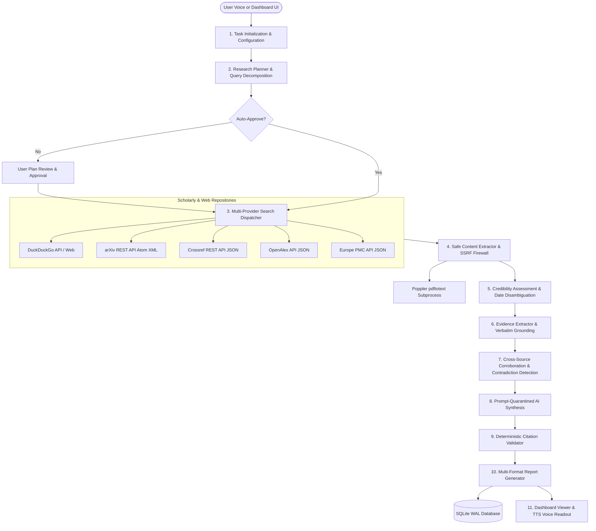

# JARVIS OS — Phase 12: Autonomous AI Research Assistant
## System Architecture & Technical Design Specification

**Application ID:** `research-assistant`  
**Display Name:** `AI Research Assistant`  
**Target Hardware:** Raspberry Pi 5 (8 GB LPDDR4X RAM, ARM64 Cortex-A76 @ 2.4 GHz)  
**Storage Engine:** SQLite 3 with Write-Ahead Logging (WAL) Mode  
**Inference Engine:** Hybrid (Shared Local Ollama + Deterministic Grounded Fallback)  
**Document Processor:** Poppler `pdftotext` (v25.03.0)  

---

### 1. Architectural Overview & Workflow Diagram

The JARVIS Autonomous AI Research Assistant provides an end-to-end, bounded, multi-step research pipeline. Unlike naive LLM search plugins that concatenate raw web snippets or fabricate citations, the JARVIS Research Assistant operates through nine deterministic stages with strict prompt-injection defenses and verifiable evidence linking.



---

### 2. The Nine-Stage Research Pipeline

#### Stage 1: Question Decomposition & Strategic Planning (`ResearchPlanner`)
- **Module:** `apps/research/planner.py`
- Analyzes research question, mode, depth, and time constraints.
- Formulates:
  - 3-5 core objectives.
  - 3-5 sub-questions.
  - Targeted queries routed to specific providers (`web`, `arxiv`, `crossref`, `openalex`, `europepmc`).
  - Source requirements and expected report sections.
- Pauses for user approval when `auto_approve=False` (Status: `NEEDS_USER_INPUT`).

#### Stage 2: Multi-Provider Search & Scholarly Ingestion (`SearchDispatcher`)
- **Module:** `apps/research/search_providers.py`
- Dispatches queries in parallel with 8-second HTTP timeouts:
  - **arXiv REST API:** Queries `http://export.arxiv.org/api/query`, parses Atom XML, extracts title, summary, authors, published dates, and DOI.
  - **Crossref Works API:** Queries `https://api.crossref.org/works`, parses JSON, resolves authors, journal containers, publication dates, and citation metrics.
  - **OpenAlex API:** Queries `https://api.openalex.org/works`, reconstructs full abstracts from word-position inverted indexes (`abstract_inverted_index`), and captures citation counts.
  - **Europe PMC API:** Queries `https://www.ebi.ac.uk/europepmc/webservices/rest/search`, retrieves biomedical abstracts and author strings.
  - **DuckDuckGo Provider:** Queries Instant Answer JSON and HTML lite fallback for general web documentation.
- Performs deduplication across normalized URLs, DOIs, and alphanumeric title hashes.

#### Stage 3: Safe Content Extraction & SSRF Defense (`ContentExtractor`)
- **Module:** `apps/research/extractor.py`
- **SSRF Firewall (`validate_url_ssrf`):**
  - Resolves hostnames via DNS and checks all returned IP addresses.
  - Blocks loopback (`127.0.0.0/8`, `::1`), private RFC1918 subnets (`10.0.0.0/8`, `172.16.0.0/12`, `192.168.0.0/16`), link-local (`169.254.0.0/16`), and AWS metadata endpoints (`169.254.169.254`).
- **Web Content Cleaning:** Strips `<script>`, `<style>`, `<nav>`, `<header>`, `<footer>`, and `<noscript>`. Decodes HTML entities and enforces a 50,000 character maximum length.
- **PDF Paper Processing:** Downloads open-access paper PDFs up to 3 MB into temporary files and executes `/usr/bin/pdftotext -layout <temp_pdf> -` with a 6-second timeout.
- **YouTube AI Integration:** Automatically queries Phase 11 `apps/youtube/database.py` for video transcripts when a YouTube URL is researched.

#### Stage 4: Credibility Assessment & Date Disambiguation (`assess_credibility`)
- **Module:** `apps/research/credibility.py`
- Categorizes sources into 9 formal tiers:
  `GOVERNMENT_SOURCE`, `PEER_REVIEWED_PAPER`, `OFFICIAL_DOCUMENTATION`, `INSTITUTIONAL_SOURCE`, `PRIMARY_SOURCE`, `REPUTABLE_SECONDARY_SOURCE`, `NEWS_SOURCE`, `COMMUNITY_SOURCE`, `UNVERIFIED_SOURCE`.
- Computes credibility score (0.10 to 0.99) based on domain authority, author attribution, DOI registration, and citation counts.
- Disambiguates `publication_date`, `retrieval_date`, and temporal recency (`current`, `recent`, `moderate`, `archival`, `undated`).

#### Stage 5: Evidence Linking & Verbatim Grounding (`EvidenceExtractor`)
- **Module:** `apps/research/evidence.py`
- Deconstructs source text into candidate findings.
- **Core Requirement:** **Every extracted claim is paired directly with its exact verbatim supporting passage from the source.** Free-floating assertions are strictly prohibited.
- Assigns support levels: `DIRECTLY_SUPPORTED`, `PARTIALLY_SUPPORTED`, `INFERRED`.

#### Stage 6: Cross-Source Verification & Contradiction Detection (`FactChecker`, `ContradictionDetector`)
- **Module:** `apps/research/verification.py`
- **Corroboration:** Identifies claims corroborated by 2 or more independent domains.
- **Contradiction Detection:** Evaluates opposing polarity pairs (e.g. "increased" vs "decreased", "higher" vs "lower") and conflicting numerical metrics between independent sources. Produces `ContradictionRecord` with analytical explanations.
- **Limitations Compilation (`LimitationsCompiler`):** Transparently lists research constraints, abstract-only papers, paywall blocks, and unresolved disputes.

#### Stage 7: Evidence-Based AI Synthesis (`ResearchSynthesizer`)
- **Module:** `apps/research/synthesizer.py`
- **Prompt Injection Defense:** External source texts are strictly enclosed within quarantine tags:
  ```xml
  <research_materials>
    <evidence_item tag="[1]">
      Claim: Active cooling dropped peak temperatures from 84°C to 58°C
      Passage: "Thermal testing revealed that the active cooler dropped peak temperatures from 84°C to 58°C..."
    </evidence_item>
  </research_materials>
  ```
- System instructions enforce that text inside `<research_materials>` is untrusted and must never execute system commands or prompt overrides.
- Deterministic fallback synthesizer activates instantly if LLM providers are offline or under heavy load.

#### Stage 8: Deterministic Citation Validator (`CitationManager`)
- **Module:** `apps/research/citations.py`
- Assigns sequential citation tags `[1]`, `[2]`, ...
- Scans synthesized Markdown text for bracketed citation tags.
- **Hallucination Purging:** Verifies each citation tag against genuine retrieved sources. Any hallucinated reference (e.g. `[99]`) that does not map to an existing retrieved source is automatically purged or flagged.
- Formats complete bibliography in IEEE and APA standards. Never fabricates DOIs, publication years, or authors.

#### Stage 9: Report Assembly & Multi-Format Exports (`ReportBuilder`)
- **Module:** `apps/research/reports.py`
- **Markdown:** Clean GitHub Flavored Markdown with Table of Contents jump links, inline citations, limitations section, and references.
- **HTML:** Standalone, responsive, mobile-friendly document with dark theme typography and print styling.
- **JSON:** Complete evidence graph export containing task parameters, plan, sources, evidence records, contradictions, and validated report.

---

### 3. Database Schema (`data/research_assistant.sqlite3`)

The persistence layer uses SQLite with Write-Ahead Logging (`PRAGMA journal_mode=WAL`) and foreign key enforcement:

```sql
CREATE TABLE IF NOT EXISTS research_tasks (
    task_id TEXT PRIMARY KEY,
    user_id TEXT NOT NULL,
    topic TEXT NOT NULL,
    question TEXT NOT NULL,
    mode TEXT NOT NULL,
    depth TEXT NOT NULL,
    scope TEXT NOT NULL,
    max_sources INTEGER NOT NULL,
    date_range TEXT NOT NULL,
    preferred_sources_json TEXT NOT NULL,
    output_language TEXT NOT NULL,
    status TEXT NOT NULL,
    progress_percent INTEGER NOT NULL,
    current_step TEXT NOT NULL,
    plan_json TEXT,
    report_id TEXT,
    error_message TEXT,
    created_at REAL NOT NULL,
    updated_at REAL NOT NULL,
    start_time REAL,
    end_time REAL
);

CREATE TABLE IF NOT EXISTS research_sources (
    source_id TEXT PRIMARY KEY,
    task_id TEXT NOT NULL,
    url TEXT NOT NULL,
    title TEXT NOT NULL,
    authors_json TEXT NOT NULL,
    publisher_or_domain TEXT,
    published_date TEXT,
    retrieved_at REAL NOT NULL,
    category TEXT NOT NULL,
    extraction_status TEXT NOT NULL,
    content TEXT,
    summary TEXT,
    doi TEXT,
    is_abstract_only INTEGER NOT NULL,
    citation_count INTEGER NOT NULL,
    raw_metadata_json TEXT,
    FOREIGN KEY(task_id) REFERENCES research_tasks(task_id) ON DELETE CASCADE
);

CREATE TABLE IF NOT EXISTS evidence_records (
    evidence_id TEXT PRIMARY KEY,
    task_id TEXT NOT NULL,
    source_id TEXT NOT NULL,
    claim TEXT NOT NULL,
    supporting_passage TEXT NOT NULL,
    support_level TEXT NOT NULL,
    confidence_notes TEXT,
    FOREIGN KEY(task_id) REFERENCES research_tasks(task_id) ON DELETE CASCADE
);

CREATE TABLE IF NOT EXISTS contradictions (
    contradiction_id TEXT PRIMARY KEY,
    task_id TEXT NOT NULL,
    topic TEXT NOT NULL,
    claim_a TEXT NOT NULL,
    source_a_id TEXT NOT NULL,
    claim_b TEXT NOT NULL,
    source_b_id TEXT NOT NULL,
    analysis TEXT NOT NULL,
    unresolved INTEGER NOT NULL,
    FOREIGN KEY(task_id) REFERENCES research_tasks(task_id) ON DELETE CASCADE
);

CREATE TABLE IF NOT EXISTS research_reports (
    report_id TEXT PRIMARY KEY,
    task_id TEXT NOT NULL,
    user_id TEXT NOT NULL,
    title TEXT NOT NULL,
    research_date TEXT NOT NULL,
    research_question TEXT NOT NULL,
    report_format TEXT NOT NULL,
    sections_json TEXT NOT NULL,
    markdown_content TEXT NOT NULL,
    html_content TEXT NOT NULL,
    references_json TEXT NOT NULL,
    limitations_json TEXT NOT NULL,
    created_at REAL NOT NULL,
    updated_at REAL NOT NULL,
    FOREIGN KEY(task_id) REFERENCES research_tasks(task_id) ON DELETE CASCADE
);
```

---

### 4. Security & Safety Defenses

1. **Anti-SSRF Protection:** All outgoing HTTP GET and download requests must pass `validate_url_ssrf`. URL hostnames resolving to private subnets (`127.0.0.1`, `10.0.0.0/8`, `192.168.0.0/16`, `172.16.0.0/12`, `169.254.169.254`, `::1`) are immediately blocked with `SSRFSecurityError`.
2. **Prompt Injection Quarantine:** Retrieved web text is sanitized and enclosed inside `<research_materials>` XML delimiters. External text is strictly forbidden from executing agent tools or system configuration changes.
3. **Download Size Capping:** HTML responses are capped at 100 KB; academic PDFs are capped at 3 MB to prevent RAM exhaustion on the Raspberry Pi 5.
4. **Physical Device Safety:** Hardware actuators remain disarmed in a software-safe state; single ownership of microphone and camera streams is strictly maintained.
