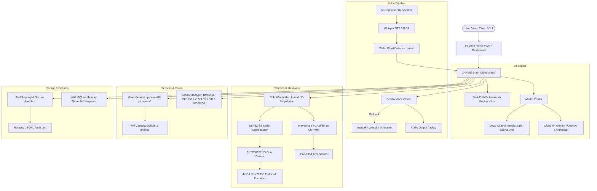

# JARVIS OS — System Architecture & Component Design

## 1. High-Level Architecture Overview

JARVIS OS is a modular, event-driven AI operating environment engineered for the Raspberry Pi 5 (8GB RAM, ARM64) and robotics peripherals.

---

## 2. Subsystem Breakdown

### A. Core Backend & Lifecycle (`apps/core/main.py`)
- FastAPI ASGI server running on Uvicorn.
- Lifespan context manager gracefully initialises SensorManager, VoiceService daemon, TaskScheduler, and RobotStateMachine.
- Clean shutdown stops background threads, disarms actuators, releases PWM outputs safely, and closes database connections.

### B. Hybrid Intelligence & Fast-Path Routing (`ai/brain.py`, `ai/local_engine.py`)
- **Fast-Path Engine**: Deterministic classification (<5ms) for time-critical commands: robot motion, sensor polling, emergency stop, math calculations, and system status queries.
- **Neural Reasoning Engine**: Local Ollama (`llama3.2:1b` / `qwen3.5:4b`) or cloud LLMs (Gemini 2.0 Flash / OpenAI GPT-4o-mini / Claude 3 Haiku) for conversational dialogue and open-domain knowledge.
- **Tool Calling Loop**: Multi-turn execution with a 5-round ceiling to prevent infinite recursion.

### C. Voice & Cloned Speech (`apps/voice/`)
- Wake word detection via boundary regex with future hooks for Porcupine and openWakeWord.
- Transcription via OpenAI Whisper (tiny model on CPU) with dummy WAV simulation support.
- `GradioVoiceCloner`: Dynamically discovers endpoints from Gradio web applications, caches synthesized WAV phrases locally, checks WAV headers, and provides instant fallback to local TTS when offline.

### D. Vision & Camera (`apps/vision/`)
- Supports native `rpicam-still` / `rpicam-jpeg` direct binary capture under Debian 13 / Python 3.14.
- Captures on-demand JPEG frames (1280x720 or 640x480) with base64 encoding for AI vision description.

### E. Motion Control & Coprocessor Link (`tools/robotics/`, `hardware/`)
- Actuators boot in a DISARMED state.
- Emergency stop permanently locks motion until cleared.
- Commands framed via checksummed ASCII/JSON protocol to ESP32-S3.
- ESP32 hardware watchdog terminates motor PWM if Raspberry Pi communication is interrupted for >500ms.

### F. Persistent Memory & Security (`memory/`, `security/`)
- SQLite database configured in Write-Ahead Logging (WAL) mode for concurrency.
- 9 supported categories: `USER`, `PROJECT`, `ROBOT`, `SYSTEM`, `CONVERSATION`, `TASK`, `KNOWLEDGE`, `PREFERENCE`, `EVENT`.
- Secure command runner enforcing an allowlist of approved Linux binaries without `shell=True`.
- Workspace directory sandboxing preventing path traversal attacks.
