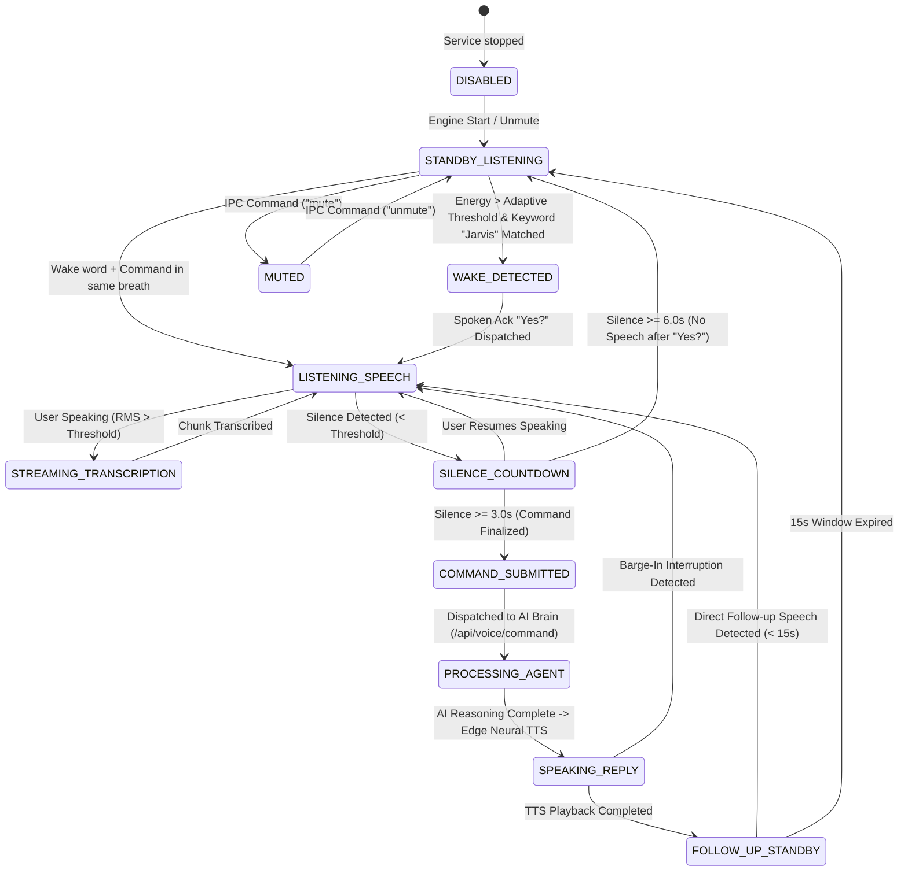

# Current verified checkpoint — 21 November 2026

Offline wake-word detection is NOT implemented or verified in this checkpoint. openwakeword, onnxruntime and pvporcupine are not installed in the project environment. The current wake_word_engine.py still calls cloud STT for standby chunks. Historical claims below that openWakeWord is activated are incorrect. Manual owner-only push-to-talk is the repaired fallback. A future local detector must consume the same owner’s PCM, require explicit opt-in and stop capture when disabled; native dependencies/models require approval before installation.

The earlier notes below are preserved for history; conflicting completion claims are superseded by this checkpoint.

---

# JARVIS OS Wake-Word Engine Architecture
**Subsystem:** `apps.voice.wake_word_engine` & `jarvis-voice.service`
**Operating Model:** Dedicated single-owner Linux systemd user daemon with IPC control

---

## 1. Overview & Architectural Goals

The JARVIS Wake-Word Engine delivers hands-free voice activation, natural multi-turn turn-taking, and instant interruption (barge-in) on the Raspberry Pi 5 without transmitting continuous ambient audio to external servers.

### Key Capabilities:
1. **Local Audio Capture & Pre-Filtering:** 16kHz 16-bit mono PCM streams acquired via PipeWire (`pw-record`) from the hardware ReSpeaker Lite microphone array.
2. **Adaptive Noise Floor Calibration:** Dynamic energy threshold tracking (RMS amplitude calculation) that smoothly adapts to room ambient noise, eliminating false triggers from air conditioning, fans, or distant chatter.
3. **Keyword Matching:** Fast speech recognition with boundary matching against configured wake phrases: `"jarvis"`, `"hey jarvis"`, `"ok jarvis"`, `"hello jarvis"`, `"wake up jarvis"`.
4. **Immediate Acknowledgment:** Audible confirmation chime / prompt (`"Yes?"`) within 300ms of wake phrase detection.
5. **Silence-Driven Command Finalization:** Automatic voice activity detection (VAD) that captures rolling speech frames and submits the completed command after 3.0 seconds of sustained silence.
6. **Follow-Up Conversation Window:** 15-second natural follow-up period allowing subsequent commands without repeating the wake word.
7. **Cross-Process Coordinated IPC:** Mute/unmute and push-to-talk handoffs preventing device lockups when the web dashboard or REST API requests one-shot capture.

---

## 2. State Machine Lifecycle



### Detailed State Specifications:

| State | Purpose | Typical Duration | Actions Executed |
| :--- | :--- | :--- | :--- |
| **`DISABLED`** | Idle / Inactive | Indefinite | Zero microphone capture. System resources freed. |
| **`STANDBY_LISTENING`** | Wake-word scanning | Continuous | Captures 1.5s rolling audio chunk. Computes RMS. If RMS > threshold, executes fast STT to match wake phrase. Updates ambient noise floor if non-speech. |
| **`WAKE_DETECTED`** | Immediate acknowledgment | 200–400ms | Halts any background media streams. Dispatches spoken prompt `"Yes?"` via fast TTS. Clears transcript buffer. |
| **`LISTENING_SPEECH`** | Command speech capture | 1–15s | Captures rolling speech frames. Appends raw PCM buffers. Continuously monitors energy level. |
| **`STREAMING_TRANSCRIPTION`** | Progressive recognition | 200–600ms/chunk | Transcribes incoming speech chunk. Updates live transcript telemetry. Resets silence timer. |
| **`SILENCE_COUNTDOWN`** | Turn finalization check | 0.0 – 3.0s | Active when speech drops below adaptive threshold. Finalizes command when timer reaches 3.0s. |
| **`COMMAND_SUBMITTED`** | Complete utterance assembly | 100–300ms | Concatenates accumulated speech buffers. Re-transcribes full utterance if chunk recognition had gaps. |
| **`PROCESSING_AGENT`** | AI Brain inference & tools | 1.0 – 4.0s | Submits prompt to `/api/voice/command`. Executes tools (system status, camera, search). |
| **`SPEAKING_REPLY`** | Audible voice delivery | Dynamic (speech length) | Plays synthesized MP3 via PipeWire (`pw-play`). Drives avatar lip-sync visemes. |
| **`FOLLOW_UP_STANDBY`** | Conversational continuity | 15.0s | Listens for direct follow-up questions without requiring the wake word. |
| **`MUTED`** | Hardware yield | During push-to-talk / test | Halts `pw-record` capture loops to yield microphone to client requests. |
| **`ERROR`** | Fault recovery | 2.0s | Logs diagnostic exception. Resets device buffers and transitions safely back to standby. |

---

## 3. Dynamic Noise Floor & VAD Tuning

To operate reliably in real-world living and office spaces without false triggering:
1. **RMS Calculation:**
   $$\text{RMS} = \sqrt{\frac{1}{N} \sum_{i=1}^N x[i]^2}$$
2. **Ambient Noise Floor Tracking:**
   $$\text{NoiseFloor}_{t} = (0.85 \times \text{NoiseFloor}_{t-1}) + (0.15 \times \text{RMS}_{\text{ambient}})$$
3. **Adaptive Trigger Threshold:**
   $$\text{Threshold} = \min\left(\max(1.8 \times \text{NoiseFloor}, \text{MinThreshold}), \text{MaxThreshold}\right)$$
   - Sensitivity `high`: Trigger at $1.4\times$ noise floor (minimum RMS 100).
   - Sensitivity `medium`: Trigger at $1.8\times$ noise floor (minimum RMS 150).
   - Sensitivity `low`: Trigger at $2.5\times$ noise floor (minimum RMS 300).

---

## 4. Acoustic Feedback & Speaker Guard

When JARVIS speaks through the physical speaker or plays media:
1. **Playback Lease Locking:** `is_playback_active()` checks active playback leases in `/run/user/<uid>/jarvis/playback-lease.json`.
2. **VAD Suppression:** During active speaker playback, the standby VAD suppresses microphone chunk evaluation to prevent JARVIS from listening to and transcribing its own voice.
3. **Emergency Barge-in:** When a user explicitly taps the microphone or triggers an interrupt command, `barge_in()` immediately kills the `pw-play` subprocess and transitions the engine straight to `LISTENING_SPEECH`.

---

## 5. Systemd User Service Integration

The wake-word daemon runs under systemd user supervision:
```ini
[Unit]
Description=JARVIS OS Background Voice & Wake-Word Service
After=pipewire.service wireplumber.service
Wants=pipewire.service wireplumber.service

[Service]
Type=simple
WorkingDirectory=/home/roshan/.gemini/antigravity/scratch/jarvis-os
Environment="DISPLAY=:0"
Environment="PYTHONPATH=/home/roshan/.gemini/antigravity/scratch/jarvis-os"
ExecStart=/home/roshan/.gemini/antigravity/scratch/jarvis-os/venv/bin/python -m apps.voice.wake_word_engine
Restart=on-failure
RestartSec=3s

[Install]
WantedBy=default.target
```
Commands to manage the daemon:
- Check status: `systemctl --user status jarvis-voice.service`
- Restart service: `systemctl --user restart jarvis-voice.service`
- Follow logs: `journalctl --user -u jarvis-voice.service -f`
