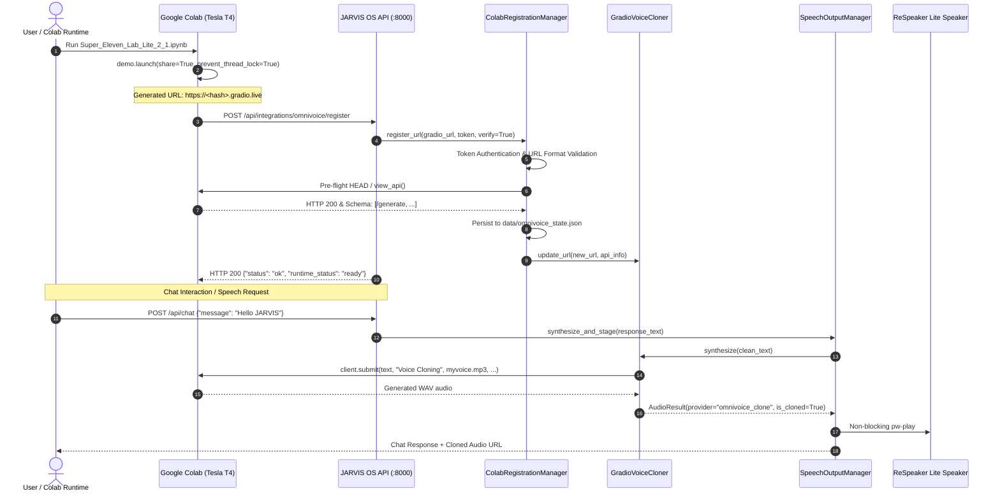

# JARVIS OS — Google Colab OmniVoice Dynamic Registration Architecture

## 1. Overview & Problem Definition

Google Colab provides high-performance GPU runtimes (e.g., Nvidia Tesla T4 16GB) capable of running advanced neural voice diffusion models like OmniVoice. However, Colab sessions:
1. Generate ephemeral Gradio share URLs (e.g. `https://<hash>.gradio.live`) that change whenever the notebook restarts or re-tunnels.
2. Terminate after periods of inactivity, disconnecting the voice endpoint.
3. Require high diffusion compute times (typically 15–25 seconds for 24 diffusion steps on Tesla T4).

The JARVIS OS Dynamic Registration Subsystem solves this by providing:
- **Zero-restart dynamic URL registration**: Colab registers its new Gradio URL with JARVIS at runtime via authenticated REST API (`POST /api/integrations/omnivoice/register`).
- **State persistence**: The active URL, session ID, registration token, and endpoint schemas are saved in `data/omnivoice_state.json`.
- **Pre-flight health checks**: Before activating a newly registered URL, JARVIS tests HTTPS connectivity and inspects the Gradio API schema to verify `/generate` exists.
- **Graceful offline fallback**: If Colab disconnects, JARVIS transparently routes all speech through high-speed edge neural TTS (`edge-tts en-GB-RyanNeural`) or local offline `espeak-ng`.
- **Truthful telemetry**: Status is clearly marked `OMNIVOICE CLONED VOICE READY` (`is_cloned: true`) only when authentic OmniVoice cloning is operating. Fallback is flagged truthfully as `OMNIVOICE OFFLINE — FALLBACK VOICE ACTIVE` (`is_cloned: false`).

---

## 2. Dynamic Registration Flow



---

## 3. Endpoints Specification

### 3.1 `POST /api/integrations/omnivoice/register` (Alias: `/api/voice/colab/register`)
Registers a new Gradio URL with security token verification.

**Request Body:**
```json
{
  "gradio_url": "https://<hash>.gradio.live",
  "token": "jarvis_omnivoice_secret_2026",
  "session_id": "google_colab_t4",
  "verify": true
}
```

**Response (HTTP 200):**
```json
{
  "status": "ok",
  "message": "OmniVoice Gradio URL registered and verified successfully.",
  "gradio_url": "https://<hash>.gradio.live",
  "session_id": "google_colab_t4",
  "runtime_status": "ready",
  "endpoints": ["/insert_tag", "/generate", ...],
  "registered_at": 1794141830.64
}
```

### 3.2 `GET /api/integrations/omnivoice/status` (Alias: `/api/voice/colab/status`)
Returns live connection telemetry for frontend dashboards.

**Response (HTTP 200):**
```json
{
  "service": "omnivoice",
  "active_url": "https://<hash>.gradio.live",
  "runtime_status": "ready",
  "session_id": "google_colab_t4",
  "registered_at": 1794141830.64,
  "last_health_check": 1794141830.64,
  "last_generation_time": 1794142100.12,
  "last_error": null,
  "verified": true,
  "endpoints": ["/generate", ...],
  "history_count": 2,
  "registration_token_masked": "jar...026",
  "cloned_voice_ready": true
}
```

### 3.3 `POST /api/integrations/omnivoice/test` (Alias: `/api/voice/colab/test`)
Triggers end-to-end synthesis in personal cloned voice and plays result through ReSpeaker Lite.

---

## 4. Security & Safety Controls
1. **Loopback & Private IP Rejection**: URLs pointing to `localhost`, `127.0.0.1`, or private ranges (`10.*`, `192.168.*`) are rejected for remote Colab registrations to prevent SSRF vulnerabilities.
2. **Shared Secret Token**: Registrations require `jarvis_omnivoice_secret_2026` (configurable via `OMNIVOICE_REGISTRATION_TOKEN` environment variable). Local requests (`127.0.0.1` / dashboard) are exempt.
3. **Diffusion Step Limiting**: Default diffusion steps are configured to 24 for optimal latency (~15–20s) while preserving speech fidelity.
