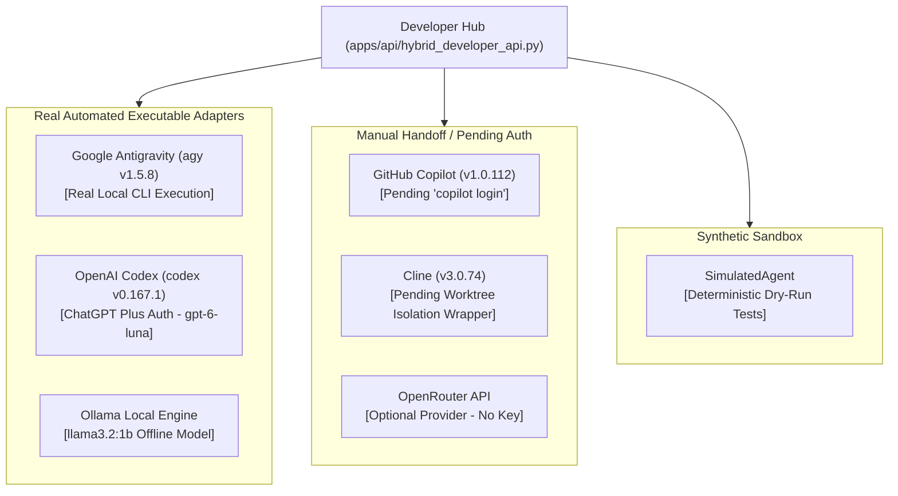

# PHASE 13A — SAFE CHECKPOINT, CLI AUTHENTICATION AND EXECUTION READINESS REPORT

**Date:** 2026-11-14  
**Agent:** Google Antigravity Pro  
**Repository Branch:** `feat/provider-adapter-dev-automation`  
**HEAD Commit:** `6c3fde9`  
**FastAPI Service:** `http://127.0.0.1:8000` (PID 42167, daemon task active)  
**Systemd Service:** `jarvis-voice.service` (active)  
**Status:** **VERIFIED & READY FOR OPERATOR REVIEW**

---

## 1. Existing Project State

- **FastAPI Core & Developer API:** The backend server is running stably on `127.0.0.1:8000`. The `/api/developer/status` endpoint confirms 3 active worktrees, 8 registered agents, and 0 failed tasks.
- **Voice Pipeline & Safety:** `jarvis-voice.service` is actively managing audio hardware. Hardware actuators remain safely disarmed (`HTTP ACTUATION DISABLED (SAFE)`); latched E-stop is functional.
- **Single-Page Application Dashboard:** All 18 primary sections load cleanly. Developer Hub (`#tab-developer`) provides live orchestration task queues, worktree collision detection, and test suite matrix.
- **Unfinished Coding Jobs:** Verified 0 hung or running sub-tasks in the queue (`data/developer_orchestration.sqlite3`).

---

## 2. Proposed Safe Git Checkpoint

To guarantee that no work is lost and no secrets are leaked:
- **Tracked Modifications Reviewed (37 files):** `ai/brain.py`, `ai/local_engine.py`, `ai/agents/task_orchestrator.py`, `ai/providers/base.py`, `apps/api/chat_api.py`, `apps/api/voice_api.py`, `apps/core/main.py`, `apps/dashboard/static/index.html`, etc.
- **New Additions to Include:**
  - `apps/api/hybrid_developer_api.py` (Developer Hub REST router)
  - `apps/core/app_factory.py` (Router registry)
  - `tests/unit/test_hybrid_developer_api.py` (Developer API test suite)
  - `tests/unit/test_phase05_provider_reliability.py` (Provider reliability test suite)
  - `tests/browser/browser_verification.cjs` & `tests/browser/screenshots/*.png` (Playwright E2E suite and 14 visual verification captures)
  - `docs/PHASE06_DEVELOPER_DASHBOARD_REPORT.md`, `docs/PHASE09_RELEASE_READINESS_REPORT.md`, `docs/PHASE12_MULTI_AGENT_INTEGRATION_REPORT.md`
  - `IMPLEMENTATION_PROGRESS.md`
- **Excluded by `.gitignore`:**
  - `.env` (API keys and credentials)
  - `data/*.sqlite3`, `data/*.db` (Runtime databases)
  - `data/audio_stage/*`, `data/screenshots/*` (Runtime media captures)
  - `venv/`, `__pycache__/`

### Proposed Checkpoint Commit Command (Awaiting Operator Approval):
```bash
git add apps/ ai/ tools/ tests/ docs/ config/ IMPLEMENTATION_PROGRESS.md package.json pyproject.toml .gitignore
git commit -m "feat(checkpoint): Phase 13A multi-agent stabilization, CLI auth verification, and developer hub"
git tag checkpoint-phase13a-verified
```
*(No `git commit` or `git merge` will be executed without explicit operator approval).*

---

## 3. Installed Coding-Agent CLI Binary Inventory & Capabilities

| Metric | Google Antigravity (`agy`) | OpenAI Codex (`codex`) | Cline (`cline`) | GitHub Copilot (`copilot`) |
| :--- | :--- | :--- | :--- | :--- |
| **Binary Path** | `/home/roshan/.local/bin/agy` | `/home/roshan/.local/bin/codex` | `/home/roshan/.npm-global/bin/cline` | `/home/roshan/.local/bin/copilot` |
| **Installed Version** | `1.5.8` | `0.167.1` | `3.0.74` | `1.0.112` |
| **Auth Method** | Antigravity session auth | **ChatGPT Plus Account OAuth** | Cline usage billing / API | GitHub OAuth / PAT |
| **Auth State** | **Authenticated** | **Authenticated (`chatgpt` mode)** | Configured (`Nemotron 3.5 VL`) | **Unauthenticated** (Requires login) |
| **Non-Interactive** | `--print` (`-p`), `--prompt` | `codex exec [PROMPT]` | `cline [prompt]` (default act) | `copilot -p [PROMPT]` |
| **Working Directory**| `--add-dir <DIR>` | `-C, --cd <DIR>`, `--worktree` | `-c, --cwd <DIR>`, `--worktree`| Operates in current working dir |
| **Sandboxing & Perms**| `--sandbox`, `--mode` | `-s <read-only\|workspace-write>` | `-y, --yolo`, `--auto-approve` | Interactive confirmation prompts |
| **Output Formats** | `text`, `json`, `stream-json` | TUI, stdout, JSON logs | `text`, `--json` | `text` stdout |
| **Timeout Support** | `--print-timeout <duration>` | Bounded subprocess timeout | `-t, --timeout <seconds>` | Standard subprocess SIGTERM |

---

## 4. Authentication Investigation

### 4.1 OpenAI Codex (ChatGPT Plus Account)
- **Status: VERIFIED AUTHENTICATED.**
- Diagnostics from `codex doctor`:
  - `stored auth mode: chatgpt` (persisted in `~/.codex/auth.json`)
  - `stored ChatGPT tokens: true`
  - `active model: gpt-6-luna (OpenAI)`
  - `websocket reachability: wss://chatgpt.com/backend-api/ (HTTP 101 Switching Protocols)`
- **Key Finding:** Codex does **NOT** require a separately billed `OPENAI_API_KEY`. It is authenticated via the operator's existing ChatGPT Plus subscription. Non-interactive task execution is immediately available via:
  ```bash
  codex exec -C <worktree-path> -s workspace-write "Your prompt"
  ```

### 4.2 GitHub Copilot
- **Status: REQUIRES OPERATOR LOGIN.**
- The CLI is installed (`copilot` v1.0.112), but requires authentication before executing prompts.
- **Operator Action Required:** To authenticate, run:
  ```bash
  copilot login
  # Or on a remote/headless terminal:
  copilot login --device-code
  ```
  Follow the on-screen link and 8-character verification code to authorize with your GitHub account.

### 4.3 Cline
- **Status: CONFIGURED (MANUAL HANDOFF RECOMMENDED).**
- Configured with Cline Usage-Billing (Nemotron 3.5 Super VL).
- Supports detached worktree creation (`--worktree`).
- Because non-interactive mode defaults to `--auto-approve true`, it is kept under **MANUAL_HANDOFF** until Phase 13B implements isolated worktree boundaries and strict diff review.

### 4.4 OpenRouter
- **Status: OPTIONAL MODEL PROVIDER (MISSING KEY).**
- Implemented as `OpenRouterProvider` in `ai/providers/base.py` for routing model calls.
- `OPENROUTER_API_KEY` is not set locally. It remains an optional external model provider for JARVIS services and will not block coding-agent execution.

---

## 5. Real vs. Manual Adapter Architecture



---

## 6. Recommended Phase 13B Implementation Steps

1. **Create Codex Worktree Adapter:** Implement `CodexCliAdapter` in `apps/api/hybrid_developer_api.py` wrapping `codex exec -C <worktree> -s workspace-write` using the verified ChatGPT Plus authentication.
2. **Execute Sample Non-Destructive Codex Task:** Queue a task in an isolated worktree (e.g., refactor or add docstrings in a test file) and verify that Codex produces a clean proposal diff without touching the main branch.
3. **Copilot Verification:** If the operator completes `copilot login`, enable automated prompt execution via `copilot -p`.
4. **Merge Quality Gate:** Continue requiring `detect_conflicts()` and quality gate test verification before presenting any proposal for human review.
