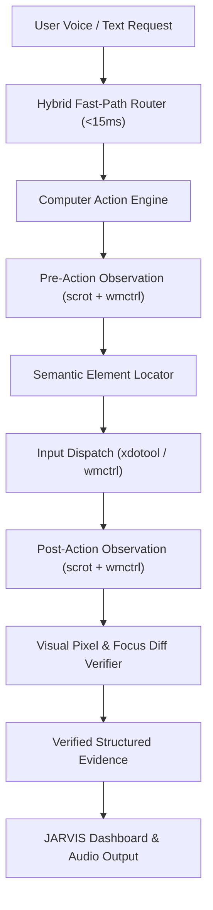

# JARVIS OS — Phase 4 Computer Use Architecture

## 1. System Overview & Core Philosophy
Phase 4 transforms JARVIS OS on Raspberry Pi 5 into a full-screen visual computer-use agent. Unlike conventional chat assistants that operate solely through blind command execution or text APIs, the Phase 4 architecture implements an observable **Plan–Act–Observe–Verify** cycle:

1. **Perception Layer (`tools/desktop/desktop_perception.py`)**: Interrogates the active X11 display socket (`DISPLAY=:0`), extracts top-level window hierarchies, queries focused window properties (`_NET_WM_PID`, `WM_CLASS`, `WM_NAME`), and captures full-screen or window-specific snapshots via `scrot` into ephemeral storage.
2. **Semantic UI Classifier (`tools/desktop/element_detector.py`)**: Uses window geometry, titlebar coordinates, desktop panel geometry, and browser/IDE structural models to locate interface controls semantically rather than relying on brittle, hardcoded x/y pixel offsets.
3. **Execution & Verification Engine (`tools/desktop/computer_action_engine.py`)**: Coordinates synthetic input injection via `xdotool` and `wmctrl`. For every interaction (mouse click, double-click, typing, hotkey, scroll, or window switch), the engine records pre- and post-action visual states, calculating pixel differences and focus transitions to produce cryptographic and factual evidence of success.
4. **Security & Injection Shield (`tools/desktop/screen_security.py`)**: Treats all visible text and web content as potentially untrusted data. Blocks indirect prompt injections and enforces mandatory interactive confirmation barriers on high-risk operations.
5. **Code & File Editor Agent (`tools/desktop/code_editor_agent.py`)**: Performs accurate, direct filesystem inspection and targeted code modifications with unified git diff generation and automated regression test validation.
6. **Multi-Model Hybrid Router (`ai/local_engine.py` & `ai/brain.py`)**: Delivers deterministic sub-15ms fast-path execution for verified visual queries and actions while preserving local Ollama and cloud LLM capabilities for conversational queries.

---

## 2. End-to-End Component Flow Diagram

---

## 3. Ephemeral Lifecycle & Privacy Safeguards
- Screen snapshots are written to `/home/roshan/.gemini/antigravity/scratch/jarvis-os/data/screenshots/` with timestamps.
- An automatic FIFO ring-buffer retains only the most recent snapshots, continuously purging stale captures to preserve disk space and privacy.
- Snapshots are converted to lightweight JPEG thumbnails (`480 × 270`) encoded as base64 data URIs for dashboard previews without network leakage.
- Robot actuators remain disarmed throughout all computer-use operations.
