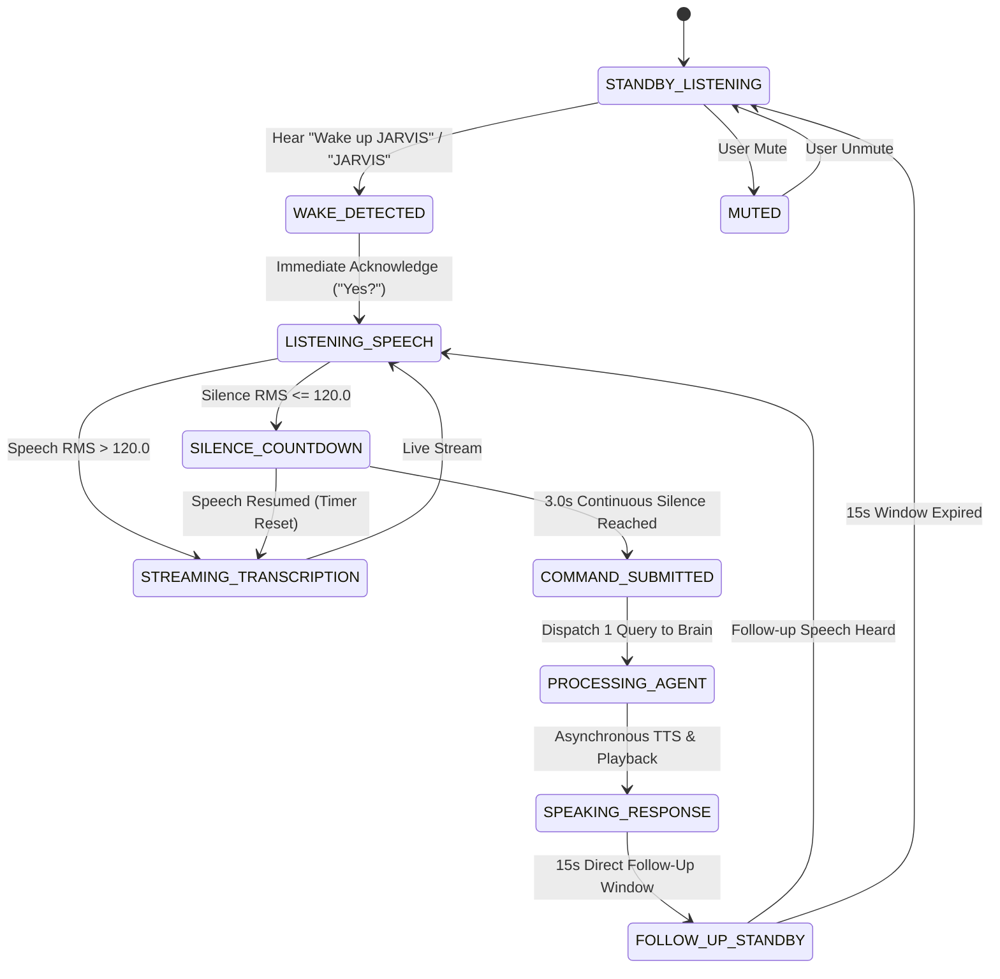

# JARVIS OS — Phase 6 Background Wake-Word Service

**Dedicated Voice Worker, 12-State State Machine, and Silence-Driven Dispatch**

---

## 1. Dedicated Systemd User Service

JARVIS includes a user-level systemd service:

`/home/roshan/.config/systemd/user/jarvis-voice.service`

```ini
[Unit]
Description=JARVIS OS Background Voice & Wake-Word Service
After=pipewire.service sound.target

[Service]
Type=simple
Environment="DISPLAY=:0"
Environment="PYTHONPATH=/home/roshan/.gemini/antigravity/scratch/jarvis-os"
ExecStart=/home/roshan/miniconda3/bin/python3 -c "from apps.voice.wake_word_engine import wake_word_engine; import time; wake_word_engine.start(); time.sleep(99999999)"
Restart=on-failure
RestartSec=5s

[Install]
WantedBy=default.target
```

### Management Commands:
```bash
systemctl --user daemon-reload
systemctl --user start jarvis-voice
systemctl --user status jarvis-voice
systemctl --user stop jarvis-voice
```

---

## 2. The 12-State Wake Word & Silence State Machine



---

## 3. Privacy & Non-Blocking Design

1. **No Cloud Audio Buffering:** Rolling audio chunks (1.5s) are recorded to temporary files in `/tmp/jarvis_voice/` and overwritten immediately. Continuous raw microphone audio is never uploaded to cloud servers.
2. **Deterministic Wake Match:** Matches `wake up jarvis`, `hey jarvis`, `hello jarvis`, `ok jarvis`, and `jarvis`.
3. **Exact 3-Second Silence Rule:** Tracks timestamp of last detected voice activity. The silence timer strictly resets whenever new speech energy (>120.0 RMS) is observed. Exactly one command is dispatched when silence reaches 3.0s.
