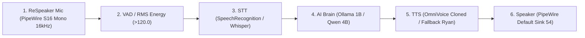

# JARVIS OS — Phase 6 Voice Diagnostics Architecture

**Independent Stage Verification & Diagnostic Reporting**

---

## 1. The 6-Stage Voice Pipeline

Phase 6 established independent verification for each stage of the voice assistant pipeline:



---

## 2. Real-Time Telemetry & API Endpoints

### `GET /api/voice/diagnostics`
Audits and returns the live status of all 6 stages without mock or simulated data:

```json
{
  "timestamp": 1794271300.0,
  "pipeline_status": "READY",
  "components": {
    "microphone_capture": {
      "status": "CONNECTED",
      "device": "Seeed ReSpeaker Lite",
      "backend": "PipeWire pw-record (s16 16kHz mono)",
      "verified": true
    },
    "voice_activity_detection": {
      "status": "READY",
      "energy_threshold_rms": 120.0,
      "silence_timeout_s": 3.0,
      "active_state": "STANDBY_LISTENING"
    },
    "speech_to_text": {
      "status": "READY",
      "engine": "SpeechRecognition (Google Web Speech API) + Whisper Fallback",
      "simulation_mode": false,
      "verified": true
    },
    "ai_response": {
      "status": "READY",
      "active_provider": "ollama",
      "active_model": "llama3.2:1b"
    },
    "text_to_speech": {
      "status": "FALLBACK_READY",
      "active_provider": "Neural Fallback (Edge-TTS Ryan)",
      "omnivoice_online": false,
      "reference_sample_available": true,
      "reference_audio_path": "/home/roshan/Downloads/myvoice_clean.wav"
    },
    "speaker_playback": {
      "status": "VERIFIED",
      "device": "ReSpeaker Lite Analog Stereo",
      "backend": "PipeWire pw-play",
      "user_audibility_confirmed": true
    }
  }
}
```

---

## 3. Dedicated Hardware Test Endpoints

1. **`POST /api/voice/test/microphone?duration_secs=3`**:
   - Records 3 seconds from ReSpeaker Lite.
   - Calculates exact RMS energy.
   - Detects silence (`rms < 15.0`).
   - Stages audio file at `/api/voice/audio/test_mic_<id>` for optional user review.
   - Transcribes real speech.

2. **`POST /api/voice/test/speaker`**:
   - Generates a 1-second 440 Hz diagnostic chime with mathematical exponential envelope decay.
   - Dispatches via `pw-play` to PipeWire default sink 54.
   - Verifies stream execution.

3. **`POST /api/voice/test/speaker/confirm`**:
   - Accepts `{"confirmed": true}` to record user audibility verification.
