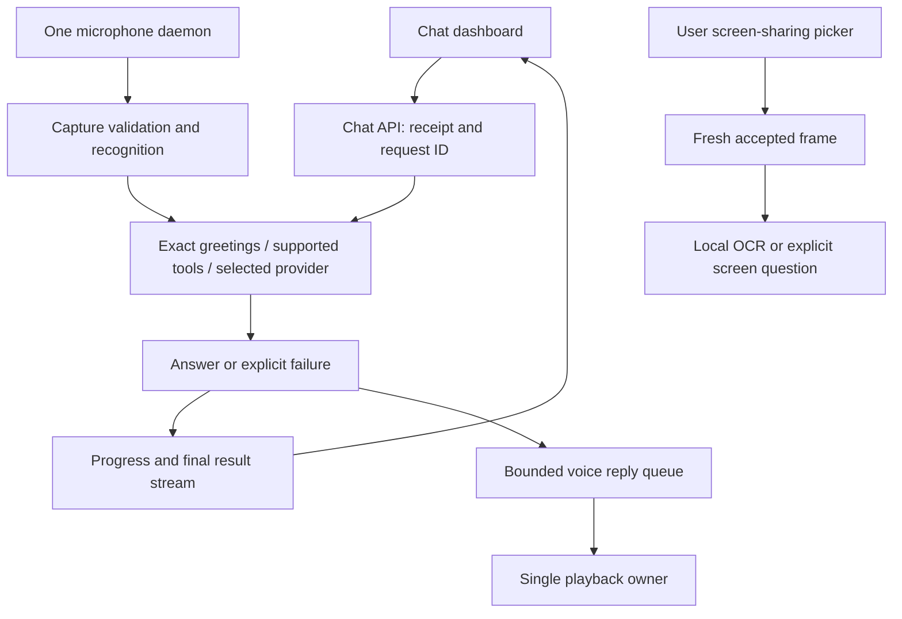

# JARVIS real-time recovery architecture

## Acceptance contract

JARVIS is a local assistant application, not a replacement operating system.
Do not call this project complete while normal chat, voice acceptance, and screen
sharing fail. A running process, HTTP 200, or passing mocked tests is insufficient.
Preserve the existing implementation and user changes. Each milestone below needs
source changes, focused automated checks, and separately recorded live acceptance.

## Incident and repair boundary

The user reports `hello` waiting for Ollama at port 11434 and failing after 45
seconds, voice input not being heard, and unreliable screen capture. Inspection
found that the dashboard ignored existing `start` and `progress` stream events;
Cancel only aborted the browser connection, without cancelling the server request.
Greetings took the neural path and failed model replies could be sent to TTS.
Those paths are repaired. Agent-mode generation still delivers its answer after
the tool loop, with immediate acknowledgement and waiting/progress events during
execution. This does not promise token-by-token tool reasoning or instant answers.
Previous tests did not establish complete acoustic or general chat acceptance.

## Target flow

1. The browser renders receipt immediately, tracks the server request ID, and
   displays progress separately from the answer. Ordinary greetings can use a
   narrow deterministic response without a model or tool. Other answers use a
   configured provider; no made-up answer substitutes for a failed model.
2. The server acknowledges the stream before expensive work and emits regular
   waiting events. Task execution emits progress and then evidence-backed results.
   Failed, cancelled, and unverified outcomes must never display "Task complete".
3. Cancel reaches both browser and server. Cancelling cannot undo an action already
   executed, and retry is never automatic for actions with unknown outcomes.
4. Provider failures have bounded latency, clear recovery guidance, and a temporary
   cooldown to avoid repeating the same long failed call. Free cloud routes must
   be explicitly configured and tested; account keys, quotas, and model availability
   are real dependencies. Do not silently switch to paid services or transmit
   private screen/transcript data to a new provider.
5. One daemon owns the microphone. Its state reports actual capture/transcription
   readiness and failure stages. Reuse the current owner for listening and testing.
   Voice output stays serialized with cancellation and feedback suppression.
6. Browser screen sharing starts only through an explicit user gesture and picker.
   Analysis requires a fresh successfully transferred frame, and controls reflect
   permission denial, stopped tracks, upload failure, or unavailable models.

## Work ownership for this increment

- Codex/root: architecture, stream acknowledgement/progress/cancellation, instant
  greeting path, provider failure handling/free-route configuration, dashboard
  integration, completion ledger and continuation prompt.
- Microphone delegate: wake/capture/transcription readiness and diagnostics in
  existing voice daemon paths, with isolated focused tests.
- Screen delegate: active-desktop lifecycle, fresh frame transfer, browser error
  handling and regression tests. Root owns shared dashboard HTML.

Do not wait idle for another agent: implement the assigned files and coordinate
interface changes. Never give multiple agents ownership of the same source file.

## Milestones and evidence rules

| Milestone | Current source status | Live acceptance |
|---|---|---|
| Canonical admin session | Implemented, focused tests passed | User signs in with existing local PIN |
| Provider key storage and diagnostics | Implemented; OpenRouter configured privately | OpenRouter free generation passed; other cloud providers unverified |
| Single voice reply queue | Implemented and final audio-session fix deployed | Live short reply queued in 23ms and completed playback in 3.56s; full acoustic conversation remains unverified |
| Immediate chat receipt and progress | Implemented and tested | Live first event 35ms, complete cloud answer 2.25s in one probe |
| Fast ordinary greeting | Implemented and tested without provider access | Live `hello` completed in 85ms using local conversation response |
| Server-side chat cancellation | Implemented; model-return/tool boundary checks | Chromium cancellation request verified; cannot undo a running action |
| Useful cloud free route | OpenRouter free route integrated and selected | Live marker test passed; arithmetic answer correct in 2.05s |
| Microphone/transcription reliability | Recorder, wake-phrase, timeout and diagnostic repairs deployed | Valid captured WAVs, zero recorder failures; complete spoken conversation pending |
| Fresh screen sharing | Lifecycle and fresh-frame repairs implemented/tested | Real picker, desktop OCR, and visual-answer acceptance pending |
| General task reliability | Not complete | Representative read-only and authorized action tasks pass |
| Unlimited autonomous capabilities | Not a deliverable | Never promise arbitrary tasks or unlimited cloud quota |

Mark source implementation and live acceptance separately. Keep outstanding
credentials, sudo authentication, browser consent, and hardware acceptance visible
in the handoff. Never store secrets, personal frames, or biometric data in reports.

## Verification on 20 November 2026

187 affected Python tests passed in 12.60s; 57 frontend tests passed. A real
Chromium test against a disposable streaming server verified visible progress,
server cancellation, and the Chat **API keys & models** shortcut. These browser
checks used a synthetic server, not cloud or hardware acceptance. Whitespace and
Python/JavaScript syntax checks passed.

Separate live checks used the running JARVIS service: a local greeting returned
in 85ms; `openrouter/free` answered a synthetic arithmetic question correctly in
2.05s; a normal explanation acknowledged in 35ms and completed in 2.25s with
accepted/start/progress/token/done events. These are measured examples, not latency
guarantees. No paid fallback was enabled. The user's supplied key was stored in
the existing private, Git-ignored environment file and never put in reports.

The recorder originally rejected PipeWire exit code 1 even after JARVIS requested
termination and a valid WAV was finalized. It now accepts that narrow case only
after format, duration, size, and freshness validation; early exits and invalid
files still fail. The existing daemon was restarted without starting a second
capture owner. Live telemetry then showed valid captures and zero failures.
The user voice unit now uses the project Python environment, with a private backup
of the previous unit. SpeechRecognition is declared and installed in that
environment; it was previously absent there. Recognition and audible responses
still need an end-to-end user utterance test.

An additional live voice-command probe returned its reply in 27ms and staged an
eSpeak file, but playback failed. Read-only inspection found the system core had
no `XDG_RUNTIME_DIR`, unlike the user's audio session. Added
`apps/voice/audio_environment.py`: the player inherits explicit routing or fills
missing runtime/bus values only from a directory owned by its own Unix user.
The helper and affected speech tests passed **32 checks in 2.23s**. After the user
restarted the core at 02:28:39 GMT on 20 November, the live retest queued a short
greeting in 23ms and completed system playback in 3.56s without error. The default
remained `openrouter/free` across this restart. This verifies the controlled
text-to-speaker delivery path, not a complete microphone-to-speaker conversation
or user-confirmed audibility. No restart is pending for these repairs.

## Cloud research and limits

OpenRouter documents the [free model router](https://openrouter.ai/docs/guides/routing/routers/free-router).
Its public model catalog listed `openrouter/free` with zero prompt/completion price
and tool support at verification time. It requires an API key and is subject to
[rate and account limits](https://openrouter.ai/docs/api/reference/limits).
[Groq](https://console.groq.com/docs/rate-limits) and
[Gemini](https://ai.google.dev/gemini-api/docs/rate-limits) also publish rate limits;
neither has been verified live for this installation. No unlimited hosted option
was established. Free routing can select different models, so availability,
latency, and answer quality vary. Keep model errors explicit and never route to a
paid model merely to hide a free-tier failure.

The provider smoke-test completion budget is now 256 tokens: a 24-token request
returned no answer on one free-model route, while a subsequent bounded request
returned the expected marker. Tests do not inspect or expose hidden reasoning.
