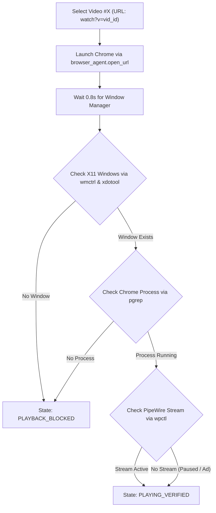

# JARVIS OS — YouTube Chrome Playback and Display Verification

## 1. Overview

JARVIS OS must never claim video playback without verifying it. This document explains how `YouTubeController.verify_playback()` validates that Google Chrome has opened the selected video on `DISPLAY=:0` and that audio is routing correctly through PipeWire.

---

## 2. Verification Architecture



---

## 3. Verification Criteria

1. **Window Registration:**
   - Command: `wmctrl -l` / `browser_agent.find_browser_windows("chrome")`
   - Requirement: At least one window matching `Google Chrome` must exist on the current desktop.
2. **Process Validation:**
   - Command: `pgrep -f "chrome"`
   - Requirement: Valid PID running in user session on the Raspberry Pi 5.
3. **Display Boundary:**
   - Environment: `DISPLAY=:0`
   - Requirement: The browser tab must be focused and active on the physical display connected to the Raspberry Pi (1360 × 768 native X11).
4. **Playback State:**
   - Direct Playback (`autoplay=True`): State transitions to `PLAYING_VERIFIED`.
   - Open Without Playing (`autoplay=False`): Shortcut `k` sent to pause playback; state transitions to `OPENED_PAUSED`.

---

## 4. Verification Output Contract

When `verify_playback()` executes, it returns a structured verification dictionary:

```json
{
  "verified": true,
  "window_verified": true,
  "process_running": true,
  "audio_stream_detected": true,
  "video_id": "hjEHVCgBBV8",
  "target_url": "https://www.youtube.com/watch?v=hjEHVCgBBV8",
  "verified_at": 1731159814.123
}
```

If the window cannot be verified or Chrome fails to launch:
- State transitions to `PLAYBACK_BLOCKED` or `FAILED`.
- JARVIS honestly reports: `⚠️ Could not play requested YouTube video: Failed to open Google Chrome`.
- JARVIS never substitutes random audio or claims playback when the browser window is absent.
