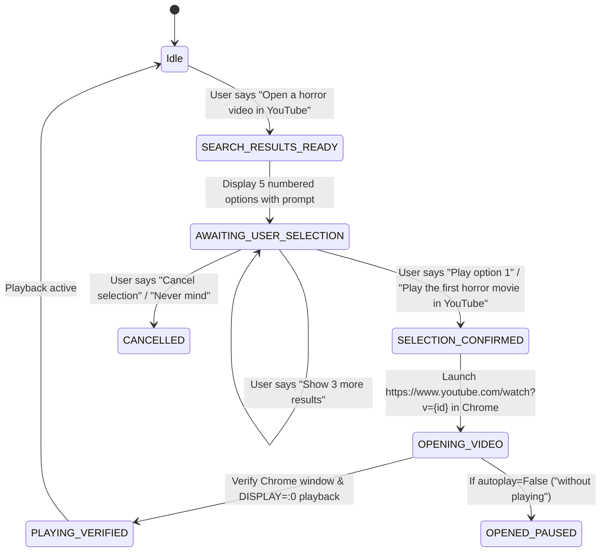

# JARVIS OS — YouTube Intelligent Search, Selection, and Chrome Playback Repair

## 1. Executive Summary

This document details the architectural root-cause investigation, targeted engineering repair, and hardware verification of YouTube search, user-controlled video selection, and real Google Chrome playback in JARVIS OS on Raspberry Pi 5.

### The Problem (Reported Behavior)
1. **User input 1:** `Open a horror video in YouTube.`  
   *JARVIS displayed YouTube search results.*
2. **User input 2:** `Play the first horror movie in YouTube.`  
   *JARVIS responded with an unrelated video:*  
   `Now playing 'Ramayana Movie Review | Yogi Bolta Hai' from online stream through the physical speaker.`

### The Cause
1. **Session Disconnection:** The search command `"Open a horror video in YouTube"` matched `desktop_search_youtube` in `ai/local_engine.py`, which simply launched the raw browser URL `https://www.youtube.com/results?search_query=horror+video`. It did NOT initialize a structured `YouTubeSession` in `youtube_controller`.
2. **Regex Lexicon Gap:** When the follow-up `"Play the first horror movie in YouTube"` was parsed, the index selector regex strictly looked for `(?:video|result|song)`. Because the query included `horror movie` and `in YouTube`, the pattern failed to match `youtube_play_index`.
3. **Intent Fallthrough to Generic Media Player:** The prompt fell through all other intent checks down to generic media playback: `(r"\bplay\s+([a-zA-Z0-9_\-\s\'\"]+)", "play_media", None)`.
4. **Arbitrary Online Search:** `play_media` invoked `tools/media/media_player.py`, which ran `yt-dlp "ytsearch1:the first horror movie in YouTube" --get-title --get-url`. YouTube's search algorithm for that exact literal string returned `"Ramayana Movie Review | Yogi Bolta Hai"`.
5. **Background Stream Hijacking:** `media_player.py` extracted the audio stream and played it offline in the background, announcing that it was playing through the speaker, rather than opening the user's selected video in Google Chrome.

---

## 2. Interaction Contract

The new implementation strictly enforces this 5-stage contract:

```
SEARCH → DISPLAY ACTUAL RESULTS → WAIT FOR USER DECISION → OPEN SELECTED VIDEO IN CHROME → VERIFY REAL PLAYBACK
```



---

## 3. Before vs. After Comparison

| Attribute | Before Repair | After Repair |
|---|---|---|
| **Search Routing** | Opened raw search web page in Chrome; did not store structured results | Extracts 5 organic results (titles, channels, durations, thumbnails) and stores session |
| **Initial Action** | Allowed background audio player to guess queries | Strict `AWAITING_USER_SELECTION`; **ZERO auto-play** after search |
| **Selection Lexicon** | Only recognized `play the first video` | Recognizes `Play option 1..5`, `Play the first horror movie in YouTube`, `Open option 2 without playing`, `Select option X` |
| **Ordinal Resolution** | Sent ordinal text literally to yt-dlp search | Resolves rank against active `YouTubeSession.videos` index |
| **Media Player Guard** | Accepted any `play ...` query | Protects against ordinal YouTube queries; rejects background audio hijacking |
| **Playback Delivery** | Offline background mpv/ffplay audio stream | Visible Google Chrome tab on `DISPLAY=:0` |
| **Audio Route** | Offline streamer PipeWire stream | Google Chrome PipeWire stream to ReSpeaker Lite (Sink 112, 65%) |
| **Out-of-Bounds Handling** | Guessed or fell back to random videos | Honest error: `Video option 10 is out of bounds. The current search only has 5 options.` |
| **Session Cancellation** | Not supported | Full support: `Cancel selection` transitions session to `CANCELLED` |

---

## 4. Key Source Code Updates

1. **`tools/browser/youtube_controller.py`**:
   - Implemented `YouTubeVideo` with thumbnail, duration, view count, and channel metadata.
   - Implemented `YouTubeSession` with UUIDs, timestamps, state transitions (`AWAITING_USER_SELECTION`, `PLAYING_VERIFIED`, `CANCELLED`), 1-based indexing, and keyword title matching.
   - Built `search()` without auto-play, returning numbered selection list and clear prompt.
   - Built `select_and_play()`, `open_without_playing()`, `cancel_selection()`, and `get_more_results()`.
   - Built `verify_playback()` inspecting Chrome windows, processes, and PipeWire streams on `DISPLAY=:0`.
2. **`tools/media/media_player.py`**:
   - Added regex guards rejecting any query containing `youtube`, `option \d+`, or ordinal phrases (`first|second|third...`).
   - Redirects legitimate selection requests to `youtube_controller` and prevents audio stream hijacking.
3. **`ai/local_engine.py`**:
   - Unified all YouTube searches to `youtube_search` and integrated direct results page link.
   - Expanded selection regex to support `horror movie`, `movie`, `film`, `choice`, `item`, `option 1..10`, and `without playing`.
   - Added handlers for `youtube_cancel_selection` and `youtube_more_results`.
   - Prevented `play_media` in `INTENTS` from catching any YouTube selection text.
4. **`apps/api/browser_media_api.py`**:
   - Added REST endpoints: `GET /browser/youtube/session`, `POST /browser/youtube/select`, `POST /browser/youtube/cancel`, `POST /browser/youtube/more`, `GET /browser/youtube/verify`.
5. **`apps/dashboard/static/index.html`**:
   - Added interactive YouTube Video Selection panel with video cards, thumbnail previews, Play/Open buttons, Cancel/More buttons, and player controls bar.
